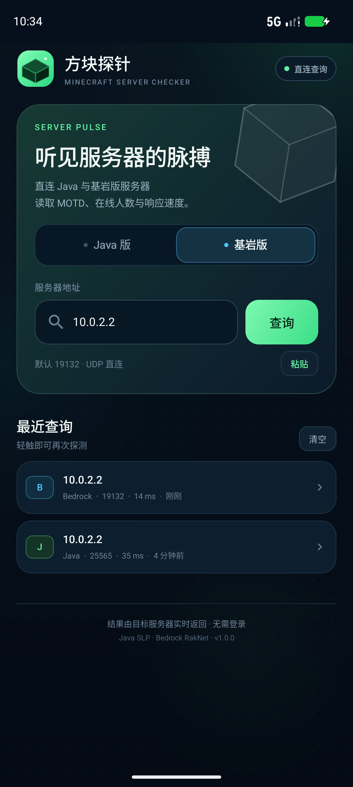
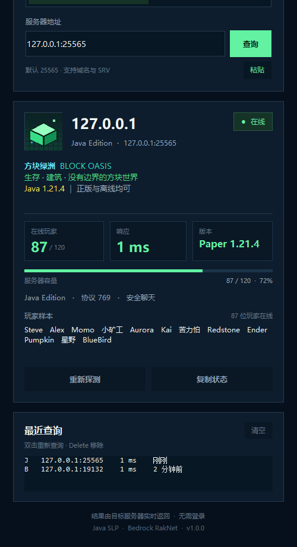
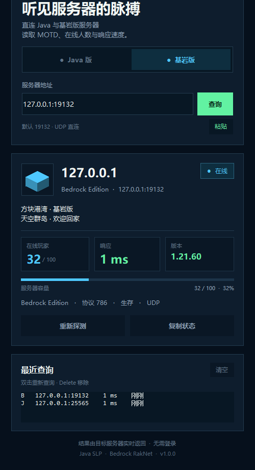

# 方块探针 · CubeProbe

Minecraft Java 版 / 基岩版服务器查询工具，覆盖 **Android / Windows / Linux / macOS / iOS**。直接连接服务器读取 MOTD、在线人数、版本、延迟与 favicon，不经过第三方查询 API。



## 功能

- **Java 版**：Server List Ping 1.7+，1.6 legacy 回退；JSON/MOTD 颜色、favicon、玩家样本。
- **基岩版**：RakNet Unconnected Ping；双行 MOTD、人数、版本、游戏模式。
- **SRV**：Java 版未显式填写端口时，通过 Cloudflare / AliDNS / Google DoH 解析 `_minecraft._tcp`。
- 深色中文界面；历史记录、双击重查、复制、分享。
- Android 原生 Java/View；桌面端 Tkinter；iOS SwiftUI + Network.framework。

## 下载

所有安装包在 [Releases](https://github.com/sunaiyun/CubeProbe/releases) 发布：

| 平台 | 文件 | 说明 |
| --- | --- | --- |
| Android | `CubeProbe-1.0.0-Android.apk` | Android 7.0+，已签名 |
| Windows x64 | `CubeProbe-1.0.0-Windows-x64.exe` | 64 位单文件 EXE |
| Windows x86 | `CubeProbe-1.0.0-Windows-x86.exe` | 32 位单文件 EXE |
| Windows 合集 | `CubeProbe-1.0.0-Windows-x86-x64.zip` | 两个 EXE + 说明 + Python 备用版 |
| Linux x86_64 | `CubeProbe-1.0.0-Linux-x86_64.tar.gz` | 自带 Python 3.12 + Tk |
| Linux 单文件 | `CubeProbe-1.0.0-Linux-x86_64.run` | 自解压版本 |
| macOS Universal | `CubeProbe-1.0.0-macOS.zip` | arm64 + x86_64 自带运行时 |
| iOS | `CubeProbe-unsigned.ipa` | 未签名 IPA，需 Sideloadly 重签 |

下载后请核对 `SHA256SUMS.txt`。

## 截图

| Android | 桌面端 |
| --- | --- |
|  |  |
|  |  |

## 仓库结构

```text
android/                Android 原生工程（aapt2/javac/d8 构建脚本）
desktop/                Python + Tkinter 桌面端
  core.py               协议实现
  gui.py                GUI
  cli.py                CLI
  build_packages.py     绿色包构建
  build_bundled.py      Linux/macOS 自带运行时构建
  packaging/            平台启动脚本
ios/                    SwiftUI Xcode 工程
  .github/workflows/    无 Mac 的云端 IPA 构建（根目录）
docs/                   截图
```

## 构建

### Android

需要 Android SDK（build-tools 36、platform android-37）、JDK 21 和 PowerShell：

```powershell
$env:ANDROID_SDK_ROOT = "D:\AndroidSDK"
$env:JAVA_HOME = "C:\Program Files\Microsoft\jdk-21.0.7.6-hotspot"
$env:CUBEPROBE_KEYSTORE_PASS = "your-keystore-password"
.\android\build.ps1
```

签名密钥 `android/signing/` 不纳入仓库；首次构建会生成新的 keystore。请使用你自己的密钥并妥善备份。

### 桌面端

```bash
cd desktop
python gui.py
python cli.py play.example.com
python build_packages.py
```

Windows x86/x64 独立 EXE 需要分别用 32/64 位 Python 3.8 + PyInstaller 5.13.2 构建，详见 `desktop/README.md`。

### iOS

- 有 Mac：用 Xcode 打开 `ios/CubeProbe.xcodeproj`，选择 Team 后运行。
- 没有 Mac：仓库自带 GitHub Actions 工作流，在 Actions 中运行 **Build unsigned iOS IPA**，下载未签名 IPA，再用 Windows Sideloadly + Apple ID 安装。详见 [ios/NO-MAC.md](ios/NO-MAC.md)。

## 已验证

- Windows 10 x64：x86/x64 EXE 均启动成功；桌面 GUI 完成 Java SLP / Bedrock RakNet 本地 mock 查询。
- Android：安装、双版本查询、历史记录已验证。
- iOS：GitHub Actions 的 macOS runner 编译成功，生成未签名 arm64 IPA；真机安装未实测。
- Linux/macOS：包在 Windows 上组装，已检查 ELF/Mach-O、Tk 与压缩包权限；未在真实系统运行验证。

## 安全与限制

- Android 发布签名密钥、GitHub Token 等敏感信息不进入仓库。
- Windows/macOS 安装包未做商业代码签名；SmartScreen / Gatekeeper 会提示未知开发者。
- iOS IPA 未签名，免费 Apple ID 签名 7 天有效。
- 基岩版状态包不返回玩家样本；SRV 依赖 DoH。
- 本项目为非官方工具，与 Mojang / Microsoft 无关联。

## 许可证

源码采用 [MIT License](LICENSE)。第三方运行时与依赖的许可证见 [THIRD_PARTY_NOTICES.md](THIRD_PARTY_NOTICES.md)。

欢迎 Issue / PR。
