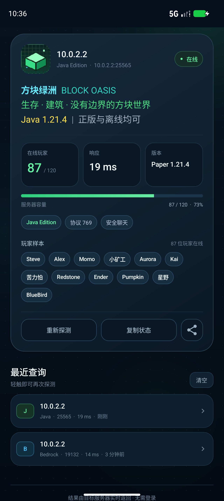
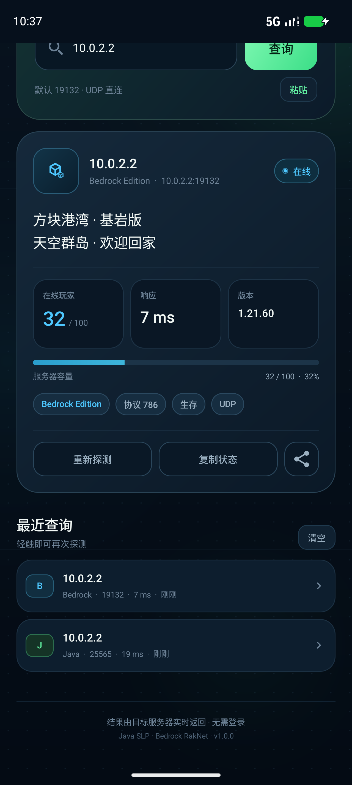

# 方块探针 · CubeProbe

一个直连 Minecraft **Java 版**与**基岩版**服务器的 Android 查询工具。输入域名或 IP，应用会用对应版本的协议直接询问服务器，展示 MOTD、在线人数、版本、协议、延迟、服务器图标与 Java 版玩家样本。

APK：`dist/CubeProbe-1.0.0.apk`  
包名：`com.cubeprobe.mc`  
最低系统：Android 7.0（API 24）  
目标 SDK：Android 15（API 35），已在 Android 17 / API 37 上安装验证


## 功能

- **Java 版直连查询**：实现 Minecraft Server List Ping（1.7+），并带有 1.6  legacy ping 回退。支持域名、IPv4、IPv6、自定义端口。
- **基岩版直连查询**：实现 RakNet Unconnected Ping（`0x01` → `0x1C`），读取双行 MOTD、协议、版本、在线人数、游戏模式等。 
- **SRV 解析**：Java 版未手写端口时，会通过 DoH（Cloudflare / AliDNS / Google）查询 `_minecraft._tcp` SRV 记录，找不到时自动回退 25565。
- **有颜色的 MOTD**：支持现代 JSON 聊天组件、`§` 颜色代码、十六进制颜色，并针对深色界面调整了可读性。
- **服务器图标**：解析 Java 版 base64 favicon，使用像素化渲染，避免 64×64 图标被模糊。
- **历史记录**：本地保存最近 8 条成功查询，支持点击重查、长按移除、一键清空。
- **可复制 / 分享**：结果卡提供重新探测、复制状态与系统分享。
- **轻量、无第三方 SDK**：纯 Java + 原生 View，无广告、无账号、无统计上报；仅申请 `INTERNET` 与 `ACCESS_NETWORK_STATE`。

### Java 版结果



### 基岩版结果



> 截图中的服务器是本地模拟服务（`10.0.2.2`），用于验证协议与界面，不是公网服务器。

## 使用方法

1. 安装 APK（允许未知来源安装）。
2. 选择「Java 版」或「基岩版」。
3. 输入服务器域名 / IP。端口可选：
   - Java 版默认 `25565`
   - 基岩版默认 `19132`
   - 支持 `host:port`、`[IPv6]:port`，也接受粘贴 `minecraft://` 链接。
4. 点击「查询」或软键盘的 Go。

查询是直接 TCP / UDP 连接目标服务器，不经过第三方查询 API。SRV 解析是唯一可选的辅助网络请求，失败不会影响手动端口的查询。

## 构建

本仓库使用一个无 Gradle 的构建脚本，直接调用 Android SDK 工具链：

- JDK 21
- Android SDK Platform 37（`platforms/android-37.0/android.jar`）
- Android Build Tools 36.0.0（`aapt2`、`d8`、`zipalign`、`apksigner`）
- PowerShell 7

```powershell
Set-ExecutionPolicy -Scope Process Bypass
.\build.ps1
```

产物会写入 `dist/CubeProbe-1.0.0.apk`。脚本会依次完成资源编译、Java 编译、D8 dex、打包、zipalign 与 APK 签名；若 `signing/cubeprobe-release.jks` 不存在，会自动生成一个新的本地签名密钥。

安装：

```bash
adb install -r dist/CubeProbe-1.0.0.apk
```

构建脚本中的 SDK 路径按当前开发机硬编码为 `D:\AndroidSDK`。换机时修改脚本顶部的 `$sdk`、`$javaHome` 即可。

## 签名

- 证书：`CN=Cube Probe, O=CubeProbe, C=CN`
- 证书 SHA-256：`ab0a084aa8a4e1ac06dabb1e572b37a503563639823b201d940aa933ef05a8fb`
- 签名方案：APK Signature Scheme v2 + v3（minSdk 24 无需 v1）
- 本地 keystore：`signing/cubeprobe-release.jks`，alias `cubeprobe`。密码通过环境变量 `CUBEPROBE_KEYSTORE_PASS` 提供，不写入仓库。

后续更新必须使用同一个 keystore，否则系统会拒绝覆盖安装。请备份 `signing/`；如果准备上架或公开分发，建议更换独立密钥并妥善保管口令。

APK SHA-256：

```text
4884A9A200D95A4606FDB833538C93AC69F75D1AABBC2BD94A5025ACFAAC9886
```

## 验证记录

在 Android 17 / API 37 模拟器（1280×2856，density 480）上完成：

- 安装签名 APK，启动无崩溃。
- Java 版查询本地 SLP mock：`Paper 1.21.4` / protocol 769 / 87–120 人 / 12 个玩家样本 / JSON 彩色 MOTD / PNG favicon，界面正确渲染。
- 基岩版查询本地 RakNet mock：`1.21.60` / protocol 786 / 32–100 人 / 双行 MOTD / Survival→“生存”，界面正确渲染。
- 两种模式的查询结果均写入本地历史记录；滚动、加载、错误提示与顶栏 insets 均验证。
- 最终 APK 的 logcat 中没有 `FATAL EXCEPTION`。

本地 mock 服务器位于 `test/mock_servers.py`（需要 Pillow），会同时监听：

- Java SLP：TCP 25565（另一组数据在 25566）
- 基岩版 RakNet：UDP 19132

```powershell
python test/mock_servers.py
```

在 Android 模拟器中查询 `10.0.2.2` 即可；真机同一局域网时填开发机局域网 IP。

## 目录结构

```text
app/src/main/           Android 源码、布局、矢量图标与资源
  java/com/cubeprobe/mc/
    MainActivity.java   单 Activity 交互、历史、分享与 insets
    net/                Java SLP、Bedrock RakNet、SRV、地址解析
    ui/                 自定义 ModeSwitch、TagFlowLayout、动效点等
    util/MotdFormatter  JSON / § MOTD 转 Spannable
    data/HistoryStore   SharedPreferences 历史
test/mock_servers.py    协议与界面测试用本地 mock
docs/                   最终实机截图
build.ps1               无 Gradle 构建与签名脚本
signing/                本地更新签名密钥（不要公开）
```

## 已知限制

- 基岩版 RakNet 状态包不包含玩家列表，因此不显示玩家样本；Java 版是否返回样本也取决于服务端配置。
- SRV 依赖 DoH。网络屏蔽 Cloudflare、AliDNS、Google DNS 时，会按默认端口直连；此时请手动填写端口。
- 不支持需要 Xbox Live 登录、查询代理白名单或非标准私有握手插件的服务器。
- 应用是竖屏界面，未做平板 / 横屏专门适配。
- 本应用是非官方工具，与 Mojang / Microsoft 无关联；Minecraft 为其权利人商标。
